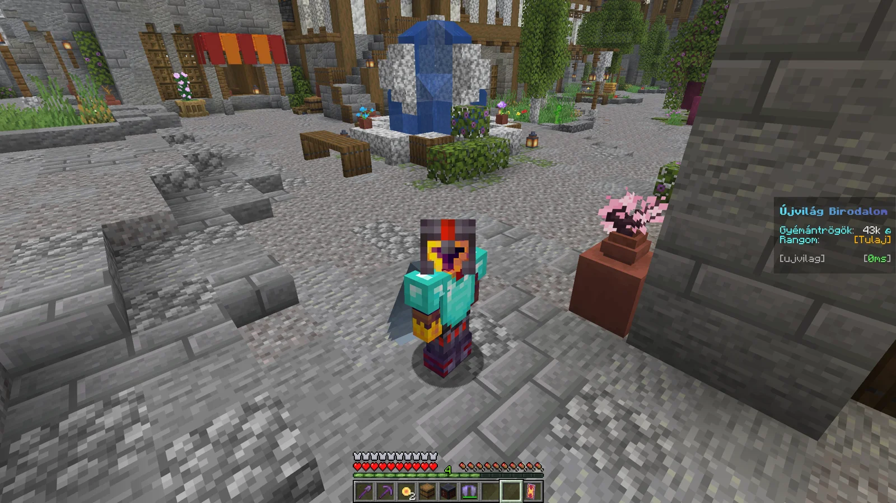
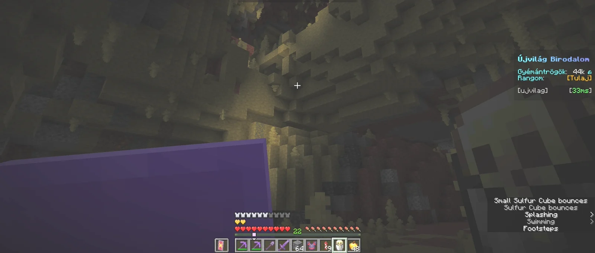

# 🌕 A kapu kinyílt — az Újvilág már 26.3-on fut!

Pár napja még csak suttogtunk egy számról. Most már kimondhatjuk hangosan: **sikerült az átkelés.** Az Újvilág Birodalom átért a túloldalra, és a szerver mostantól a **Minecraft 26.3**-as verzióján fut.

<!-- more -->

{ width="600" }

A birtokaid, a ládáid, a rangod és a szerzett tudásod mind velünk tartott. A pluginek egyenként átkerültek, a határkövek a helyükön, a gyémántrögök a zsebedben.

## Amit a mélyben találtunk

Emlékszel a furcsa zajokra a föld alól? Nem képzelődtél.

{ width="600" }

Az új verzióval megjelentek a **Sulfur Caves** — sárgás, kénes falú barlangok, ahol a csendet csak valami **pattogó** dolog töri meg időnként. Hogy pontosan mi az? Menj le, és nézd meg magad. 🟨

!!! tip "Felfedezőknek"
    Az új barlangok jellemzően **új, még be nem járt területeken** generálódnak. Ha keresed őket, indulj a megszokott vidéken túlra.

## ⚠️ Két nap béta üzem

Bármilyen alaposan is készültünk, egy ekkora költözésnél mindig maradhat valami, ami csak éles terhelés alatt bukik elő. Ezért a szerver **az elkövetkező két napban (október 21-ig) béta üzemmódban fut.**

Ez a gyakorlatban annyit jelent:

- **Játszhatsz rendesen** — építs, bányássz, fedezd fel az új barlangokat.
- Ha viszont **komoly hiba** jön elő (elveszett tárgyak, sérült világrész, nem működő alaprendszer), akkor **visszaállunk a frissítés előtti mentésre**.
- Egy ilyen rollback esetén **a frissítés óta szerzett haladás elveszhet** — tárgyak, építések, megtett utak egyaránt.

!!! warning "Mit érdemes most kerülni?"
    A béta idején ne kockáztass olyat, amit fájna elveszíteni: nagy értékű kereskedéseket, ritka tárgyak elhasználását vagy hatalmas építkezések befejezését érdemes **október 21. utánra** hagyni.

Ha két nap alatt nem jön elő semmi komoly, a béta címke lekerül, és minden, amit addig csináltál, **véglegesen megmarad**.

## Ha hibát találsz

Minden bejelentés aranyat ér ebben a két napban! Ha valami furcsát tapasztalsz — eltűnt tárgy, nem működő parancs, rosszul viselkedő plugin —, írd meg a `💡-ötletek-és-hibajelentés` fórumban a Discordon. Minél pontosabban leírod, mi történt (hol, mikor, mit csináltál előtte), annál gyorsabban tudjuk javítani.

*A kapu nyitva. Lépj át — de az első két napban még tartsd a kezed a kilincsen.* 🗝️

[:fontawesome-brands-discord: Csatlakozz a Discordhoz](https://discord.gg/MdBWZhAgCy){ .md-button .md-button--primary }
